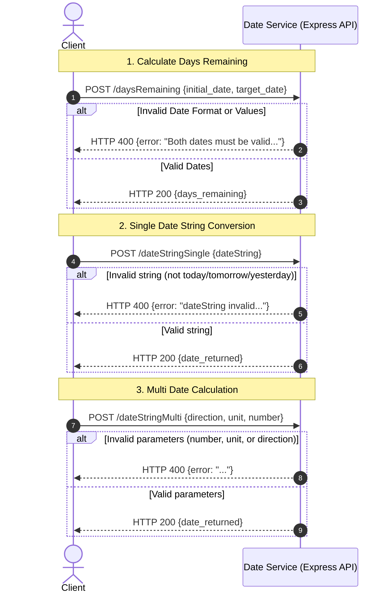

# Date Service

A REST API microservice built with Node.js and Express for date conversions and calculations.

## Features

- Calculate days remaining between two dates.
- Convert today, tomorrow, and yesterday into dates.
- Calculate future or past dates using days, weeks, months, or years.

## Setup

Install dependencies:
```bash
npm install
```

Start the server:
```bash
node index.js
```

The microservice runs at http://localhost:3001.

## Communication Contract

The service uses HTTP POST requests and returns JSON responses.

| Endpoint | Request Fields | Response Field |
|---|---|---|
| /daysRemaining | initial_date, target_date | days_remaining |
| /dateStringSingle | dateString | date_returned |
| /dateStringMulti | direction, unit, number | date_returned |

### Requesting and Receiving Data

Example JavaScript request:

```javascript
const response = await fetch("http://localhost:3001/daysRemaining", {
    method: "POST",
    headers: { "Content-Type": "application/json" },
    body: JSON.stringify({
        initial_date: "2026-11-16",
        target_date: "2026-11-20"
    })
});

const data = await response.json();
console.log(data.days_remaining);
```

Example response:
```json
{
    "days_remaining": 4
}
```

Successful requests return status 200. Invalid requests return status 400 with an error message.

Dates use the YYYY-MM-DD format. Negative values for days_remaining indicate overdue dates.

## Testing

Start the server in one terminal:
```bash
node index.js
```

Run the test program in another terminal:
```bash
node test_client.js
```

The test program sends HTTP requests to all three endpoints and displays the responses.

## UML Sequence Diagram

## UML Sequence Diagram


